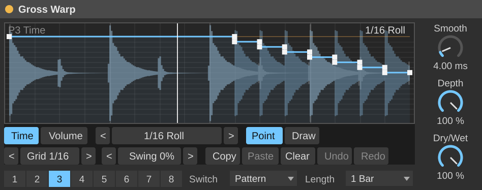

# Gross Warp — a Gross Beat-style Max for Live audio effect

Half time, tape stops, stutters, rolls, scratches, reverses and gates, drawn as two envelopes and locked to your song.



*The picture is rendered by `tools/preview.js` from the real editor script and the simulated DSP, with Live's own
dials and menus mocked; Live draws them slightly differently.*

## Install

Needs Ableton Live 12 Suite (or Live Standard with the Max for Live add-on); Max 8.6 or 9, bundled with Live, is enough.

1. Copy the folder **`dist/Gross Warp/`** (both files: `Gross Warp.amxd` and `gw_ui.js`) to your User Library, e.g.
   `~/Music/Ableton/User Library/Presets/Audio Effects/Max Audio Effect/Gross Warp/` (macOS) or
   `\Users\<you>\Documents\Ableton\User Library\Presets\Audio Effects\Max Audio Effect\Gross Warp\` (Windows).
2. In Live's browser, open *User Library*, and drag **Gross Warp** onto an audio track, a drum rack, the master, …
3. Press play. The effect follows Live's transport; with the transport stopped it passes audio through untouched.

The `.amxd` loads `gw_ui.js` from its own folder, so keep the two together. To share a single file, open the device in
the Max editor (the wrench icon in the device's title bar), click **Freeze** (the snowflake), and save it under a new
name: the script is then embedded.

## How it works in one paragraph

The display shows one pattern (1 beat, 2 beats or 1 bar long). The **time envelope** (blue) says how far behind "now"
the sound plays: at the top it is live; lower plays later, down to one whole pattern late at the bottom. So its
**slope is a speed**: flat = normal speed, falling at 45° = stopped, steeper = backwards, rising = faster than live
(catching up), and a **staircase repeats** the same slice (each step down by one grid step replays it). The **volume
envelope** (orange) is a gain: top = full, bottom = silent. Steps in the time envelope are cross-faded over *Smooth*
ms, so they don't click.

## Controls

| Control | What it does |
|---|---|
| **1–8** (Pattern) | The pattern to play and edit. Automate it, or map it to Push / a controller, to switch effects in time. |
| **Switch** | When a new pattern takes over: *Instant*, next *1/16*, next *Beat*, or the end of the current *Pattern*. |
| **Length** | Pattern length: 1 beat, 2 beats or 1 bar (4/4). |
| **Smooth** | Cross-fade time for jumps in the time envelope, and slew of the volume envelope (0.1–50 ms). |
| **Depth** | Scales both envelopes (0 % = no effect). |
| **Dry/Wet** | Mix with the input. At *Normal* the wet signal is identical to the dry one, so mixing never phases. |
| **Time / Volume** | Which envelope you edit (the other is shown faintly). |
| **< preset >** | Load a preset shape into the edited envelope; click the name for the full list. |
| **Point / Draw** | Editing tool (below). |
| **Grid** | Snap: Off, 1/4, 1/8, 1/16, 1/32, 1/8T, 1/16T. Click the name to cycle. |
| **Swing** | Moves every second grid line later (0–75 %). Click the value to reset. |
| **Copy / Paste** | The edited envelope; the clipboard is shared by every Gross Warp in the set. |
| **Clear / Undo / Redo** | Reset the edited envelope to neutral; undo/redo editor changes. |

### Mouse

| Point tool | |
|---|---|
| Click empty space | Add a point (snapped to the grid; time offsets also snap vertically to grid steps). Keep dragging to place it. |
| Drag a point | Move it (it can't pass its neighbours; the first and last stay at the ends). Two points on the same grid line make a step. |
| Drag a small circle | Bend that segment. **Alt**-click the circle: straight again. |
| **Alt**-click or double-click a point | Delete it. |
| **Shift** while clicking/dragging | No snapping. |

| Draw tool | |
|---|---|
| Click / drag | Paint flat steps, one grid cell at a time (1/32 with the grid off). |
| **Alt**-drag | Erase to neutral. |

### Presets

**Time:** Normal, Half Time, Half Time 1/2, Tape Stop, Tape Stop Bar, Tape Start, Reverse 1/2, Reverse Beats,
1/16 Roll, Stutter 1/4, Roll Build, Scratch, Slow > Fast, Delay 1/8.
**Volume:** Full, Gate 1/8, Gate 1/16, Trance Gate, Pump 1/4, Fade In, Fade Out, Off-Beat, Chop Last Beat, Swell 1/2.

The eight patterns start as: 1 Normal · 2 Half Time · 3 1/16 Roll · 4 Tape Stop · 5 Reverse 1/2 · 6 Gate 1/16 ·
7 Stutter 1/4 + Trance Gate · 8 Scratch + Pump 1/4. Step sizes in presets are fractions of the pattern, so they get
shorter with a shorter *Length*.

Everything you draw is saved with the Live set. Save a Live device preset (the floppy icon) to keep a set of eight
patterns for other projects.

## Inside

```
plugin~ ─► gen~ (src/gross_warp.genexpr) ─► plugout~
phasor~ 1n @lock 1 (Live's bar position) ─► gen~        gen~ ─► playhead, playing pattern ─► editor
editor (jsui, src/gw_ui.js) ─► buffer~ ---gwenv (envelope points) ─► gen~
gen~ ─► buffer~ ---gwpeaks (waveform peaks) ─► editor
```

- gen~ records the input into a 2 × 2²⁰-sample ring (≈ 22 s at 48 kHz) and reads it `offset` samples behind with
  4-point Hermite interpolation; the tempo comes from the slope of the bar phase. Envelope points are evaluated
  exactly every sample (steps stay sharp, ramps smooth). A jump in the offset starts an equal-power cross-fade from the
  old read head; the volume is slewed.
- The editor keeps 8 × 2 envelopes of up to 128 points (x, level, curve) and mirrors each change into the buffer. Its
  data is a hidden "blob" parameter, saved in the Live set; Live is told about a change once per edit (mouse-up), so
  Live's undo history gets one step per edit.
- `---` buffer names are made unique per device by Max for Live, so several Gross Warps never share envelopes.

## Development

Plain Node (20+), no dependencies, no Max needed:

```
cd m4l/gross-warp
npm test            # 54 tests: DSP, editor, device file, lint (~30 s)
npm run build       # rebuild dist/ after changing src/
node tools/preview.js   # re-render docs/preview.svg
```

- `tools/gensim.js` runs the gen~ codebox text itself (a small GenExpr simulator), fed by envelopes the real editor
  script wrote, so DSP tests check e.g. that *Half Time* reads at exactly half speed and *Normal* is bit-identical.
- `tools/build.js` writes the device: the patcher JSON with the genexpr embedded in the gen~ codebox, in the `.amxd`
  container (`ampf`/`aaaa`, `meta`, `ptch` chunks — the layout Ableton's `maxdevtools` reads). `--check` fails if
  `dist/` is stale; a test runs it.
- The lint tests hold the sources to what Max accepts: ES5 for `jsui`; for gen~, `peek` only as a plain assignment, no
  `break`/`+=`, no names that are gen~ operators, every variable first set at top level.

## If something is off on first load

This device was built and tested headless; it has not been opened in Max or Live yet. Open Max's console (the device's
title bar menu → *Open Max Window*, or the editor's *Window → Max Console*) and look for:

| Symptom | Likely cause and fix |
|---|---|
| Grey/empty display, console says it can't find `gw_ui.js` | The script isn't next to the `.amxd`. Copy both files, or freeze the device. |
| A gen~ error, audio silent | The codebox didn't compile: open the device in the Max editor, double-click `gen~`, and the error is shown under the code (please send it to me). |
| Editor works but the sound never changes | gen~ didn't pick up the envelope buffer (it is pointed at it by the message `gwenv <name>` at load). Look for a gen~ or `buffer~` line in the console and send it to me. |
| Drawings aren't there after reopening the set | The jsui blob parameter didn't store. Device presets still keep them; please report it. |
| Nothing happens while Live is stopped | By design: it passes audio through until the transport runs. |

## Not done (yet)

- **Pitch lock** (time effects without the pitch change): needs a granular / phase-vocoder engine.
- **MIDI-triggered patterns**: Max audio effects receive no MIDI; automate *Pattern* instead.
- Patterns longer than a bar, and meters other than 4/4.
